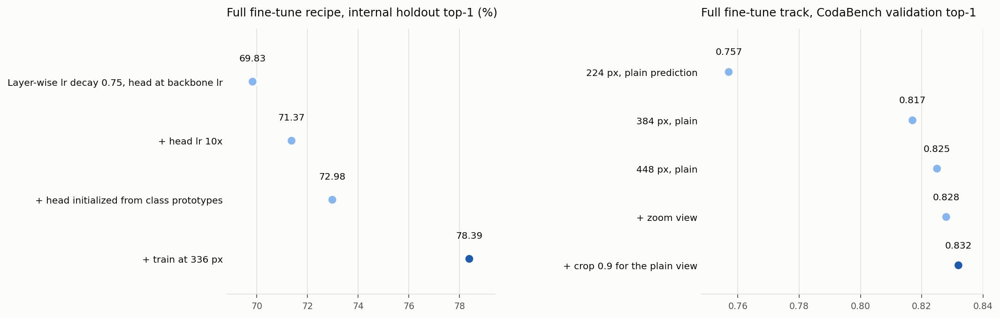
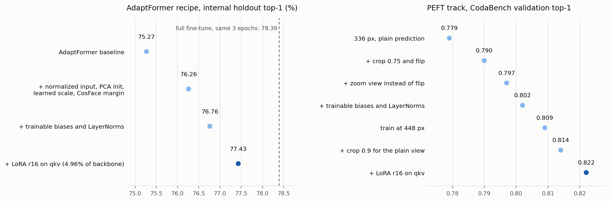

# Fine-Grained Image Classification with ViT-B/16: Full and Parameter-Efficient Fine-Tuning

**Full fine-tuning** and **parameter-efficient fine-tuning** of a ViT-B/16 for **10,000-class fine-grained image classification**
(species photos, 45 labelled images per class) under a fixed compute budget. Built for the
CS604 group project (Singapore Management University, MITB, 2026).

**Final results on the course's CodaBench leaderboard** (top-1 accuracy on 50,000 validation images whose labels are hidden):

| Track | Constraint | My best |
| --- | --- | --- |
| Full fine-tuning (Task 1) | none | **0.832** (0.8291 on the hidden Phase 2 test set) |
| Parameter-efficient fine-tuning (Task 2) | at most 5% of backbone parameters trainable | **0.822** (AdaptFormer + LoRA, 4.94%) |

Both tracks: the same ViT-B/16 backbone (`augreg2_in21k_ft_in1k`), 2 GPU-hours on a 48 GB card.

## What I built

This repository is my own training and evaluation pipeline for the project. I developed the
recipes for both tracks; teammates worked on LoRA-only, partial fine-tuning and the kNN re-ranker
(credited below).

### Full fine-tuning



- **Recipe**, built one controlled ablation at a time on the internal holdout:
  - layer-wise learning-rate decay (0.75); without it, accuracy fell 6.7 points;
  - a 10x learning rate for the classifier head (+1.5);
  - the head initialized from class-mean features ("prototypes") instead of a linear probe, with a cosine classifier (+1.6);
  - drop path 0.1, label smoothing 0.1, gradient clipping, and a cosine schedule fitted to the compute budget.
    A constant learning rate instead cost 9 points.
- **Resolution:** 224 → 336 px added 5.4 points on the holdout at equal epochs. At equal compute, 448 px
  was best; 512 px added nothing more. The final 448 px run scored 0.825 on CodaBench, and 0.832 with
  the zoom view below.

### Parameter-efficient fine-tuning



- **AdaptFormer from scratch** (`src/cs604/models/build.py`). Parallel bottleneck adapters are
  added to every MLP block. Three changes made it stronger, each kept only if it won its controlled
  ablation:
  - adapter input from the normalized stream;
  - **PCA initialization** of the down-projection from calibration activations;
  - a learned per-block scale, with a **CosFace-margin cosine head** initialized from class prototypes.
- **Hybrid PEFT.** On top of that: trainable biases and LayerNorm weights (BitFit-style), and
  **LoRA r16 on the attention qkv**. That is 4.94% of the backbone at 448 px, under the 5% cap.
- **"Look, then zoom in" at prediction time** (`src/cs604/engine/zoom.py`). A class-specific saliency map
  on the patch grid picks the smallest window holding 70% of the evidence. That window is
  re-classified from a 2x-resolution copy, with no retraining. It beat flip averaging at the same cost (+0.85 on the holdout,
  +0.7 on CodaBench). It helped both tracks.

### Across both tracks

- **Experiment discipline.**
  - A fixed internal holdout (5 images per class, all 10,000 classes).
  - A step-zero accuracy gate, so every run starts from the same verified model.
  - A pre-set 0.4-point tie rule.
  - Two-seed reruns for the headline claims.
  - Every run records its resolved config, Git commit, hardware, parameter counts and timing.
- **Engineering.** bf16 with gradient checkpointing, so ViT-B fits on a 16 GB laptop GPU. Resumable checkpoints
  restore the optimizer, scheduler and data position. Training stops on a compute budget measured in
  GB-hours. 126 unit tests run without the dataset.

## Key findings

| Question | Result |
| --- | --- |
| Full FT: what matters most in the recipe? | Layer-wise lr decay (−6.7 without it) and the cosine schedule (−9.0 with a constant lr); then a prototype-initialized head (+1.6) and a 10x head lr (+1.5) |
| Do PCA init, normalized input, learned scale and margin help AdaptFormer? | +0.99 points at 3 epochs, a win at every epoch |
| Does adding LoRA beat spending the same parameters on wider adapters? | **Yes: +0.59**, in both seeds |
| Does AdaptFormer + LoRA beat LoRA alone at equal parameters? | No: +0.17, a tie. I report this rather than overclaim. |
| Does training resolution matter, at equal compute? | 336 → 448 px: +3.1 (AdaptFormer), +1.6 (full FT). Full FT is flat from 448 to 512. |
| Is the zoom view better than flip? | +0.85 on the holdout and +0.7 on CodaBench, at the same 2 forward passes |
| SSF (scale-and-shift) instead of biases/norms? | Tie, at 21% lower throughput, so not used |

More detail is in [docs/RESULTS.md](docs/RESULTS.md).

## Repository layout

```
src/cs604/
  models/build.py      ViT construction, AdaptFormer, LoRA, SSF, cosine head, PCA init, param groups
  engine/loop.py       training loop: budgeted cosine schedule, bf16, resumable checkpoints, holdout eval
  engine/zoom.py       saliency-guided zoom view
  engine/predict.py    batched prediction with crop, flip and zoom; submission checks
  data/dataset.py      dataset and fixed per-class holdout split
scripts/               train, predict, prototypes, evaluation studies (zoom, TTA, kNN, fit, errors)
configs/               base configs; configs/experiments/ holds the final runs and key ablations
tests/                 unit tests (no GPU or dataset needed)
```

## Running it

Requires Python 3.10+ and a CUDA build of PyTorch ([pytorch.org](https://pytorch.org/get-started/locally/)).

```bash
pip install -r requirements.txt
python -m unittest discover -s tests            # 126 tests, no dataset needed
python scripts/train.py --config configs/smoke.yaml --synthetic   # 5-step GPU check, no data
```

With the dataset ([doem1997/cs604-course-data](https://huggingface.co/datasets/doem1997/cs604-course-data), about 45 GB):

```bash
python scripts/download_dataset.py --local-dir data
python scripts/build_prototypes.py --config configs/experiments/prototype_init.yaml       # also writes the holdout split
python scripts/build_prototypes.py --config configs/experiments/prototype_init_336.yaml
python scripts/train.py --config configs/experiments/af_lora_r16_e3.yaml
python scripts/predict.py --checkpoint outputs/af_lora_r16_e3/best.pt --data-root data \
    --split val --output outputs/val.txt --crop-pct 0.9 --zoom
```

The final training runs used a Colab A100 40 GB. Tuning and ablations ran on an RTX 5080 laptop GPU.

## Team and credits

This was a four-person group project. The team's final submissions used my Task 1 and Task 2
recipes, ported into the shared team trainer (I checked that the port gives identical logits). They also used
a kNN re-ranker written by a teammate, which brought Task 1 to 0.8384 on the hidden Phase 2 test set.
The teammates' LoRA, partial fine-tuning and kNN code lives in the team repository and is not included here.
